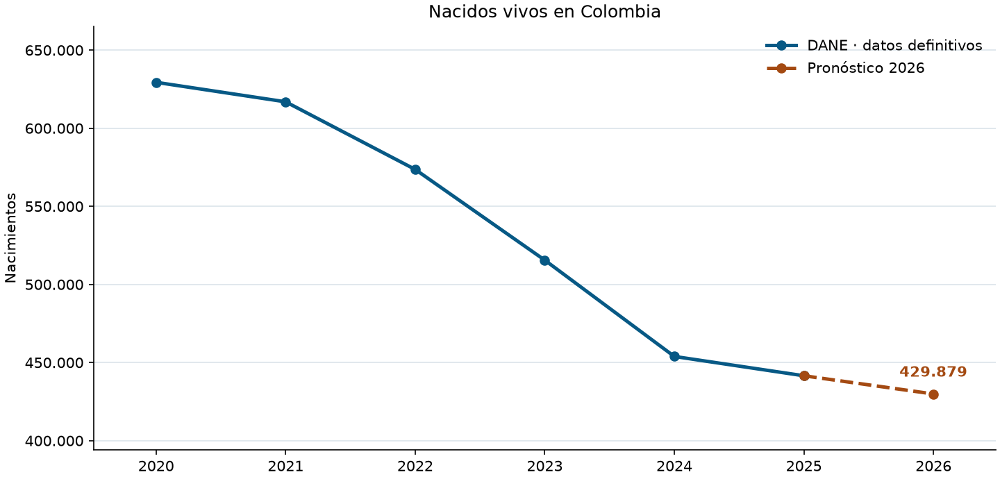

# Pronóstico de nacimientos en Colombia para 2026

**Investigación aplicada de Juan Diego Londoño Álvarez**

¿Qué tan bien se pueden anticipar los nacimientos de un año a partir de los conteos anteriores? Este proyecto retoma un modelo departamental desarrollado durante la Maestría en Inteligencia Artificial, contrasta su pronóstico de 2024 con las cifras definitivas del DANE y amplía la serie hasta 2025 para estimar 2026.

**El bosque aleatorio estima 429.879 nacidos vivos en 2026**, un 2,64 % menos que en 2025. Un escenario nacional que incorpora el corte preliminar de enero a julio estima **448.222**. La diferencia muestra cuánto cambia la lectura al incorporar datos de 2026.



## De los registros al pronóstico

La unidad de análisis es el departamento de **ocurrencia** del nacimiento, con Bogotá, D. C. como territorio adicional. El conjunto reúne 198 filas de 33 territorios en seis años. Los conteos de 2020 a 2023 se obtuvieron agrupando los microdatos del DANE. Para 2024 y 2025 se usó el total por departamento del Cuadro 2 de los anexos definitivos.

La regresión lineal y el bosque aleatorio estiman el cociente entre los nacimientos de un año y los del anterior. Las entradas son el año objetivo y el conteo anterior de cada territorio. La referencia simple repite el último conteo. Las estimaciones se redondean por territorio y el total nacional es la suma de las 33 predicciones.

## Validación temporal

Cada prueba entrena con los años anteriores y predice el siguiente. El bosque obtuvo el menor error absoluto medio territorial (MAE) promedio de los tres cortes. En 2025, la referencia simple se adaptó mejor a la desaceleración de la caída.

| Año de prueba | DANE | Bosque aleatorio | Error nacional | MAE territorial del bosque |
| --- | ---: | ---: | ---: | ---: |
| 2023 | 515.549 | 533.587 | +3,50 % | 725 |
| 2024 | 453.901 | 461.472 | +1,67 % | 612 |
| 2025 | 441.537 | 399.030 | −9,63 % | 1.290 |

MAE territorial promedio, en nacimientos por territorio: **876** para el bosque, **1.384** para la referencia simple y **1.724** para la regresión. Los mismos tres cortes se usaron para seleccionar el modelo. La serie es corta y un giro reciente puede cambiar el resultado. [Métricas por año y modelo](resultados/validacion_temporal.csv)

## Cómo interpretar 2026

El bosque se ajustó con datos definitivos hasta 2025. Sus mayores estimaciones por lugar de ocurrencia corresponden a Bogotá (**63.546**), Antioquia (**50.789**) y Valle del Cauca (**33.074**). [Pronóstico por territorio](resultados/pronostico_2026.csv)

El DANE informó **253.175 nacimientos preliminares entre enero y julio de 2026**, frente a **249.399** para el corte comparable de 2025 (+1,51 %). Si ese cambio se mantuviera en el total anual, la estimación sería de **448.222 nacimientos**. Es un escenario de sensibilidad basado en una hipótesis explícita. Las dos cifras de 2026 son estimaciones del proyecto y todavía falta el cierre anual definitivo. [Boletín del DANE, gráfico 2](https://www.dane.gov.co/files/operaciones/EEVV/2026/24-sep-2026/bol-EEVV-Isem2026pr.pdf) · [Comparación de escenarios](resultados/escenarios_2026.csv)

## Cómo reproducirlo

Con Python 3.11 o posterior, ejecuta desde la raíz del repositorio:

```bash
python -m pip install -r requirements.txt
python pronosticar.py
```

El proyecto incluye el panel agregado que usa el modelo. El [cuaderno de investigación](pronostico_nacimientos.ipynb) permite explorar la serie, las métricas y la proyección territorial. Para reconstruir el panel desde los archivos oficiales, consulta las [fuentes y los pasos de preparación](data/FUENTES.md).
